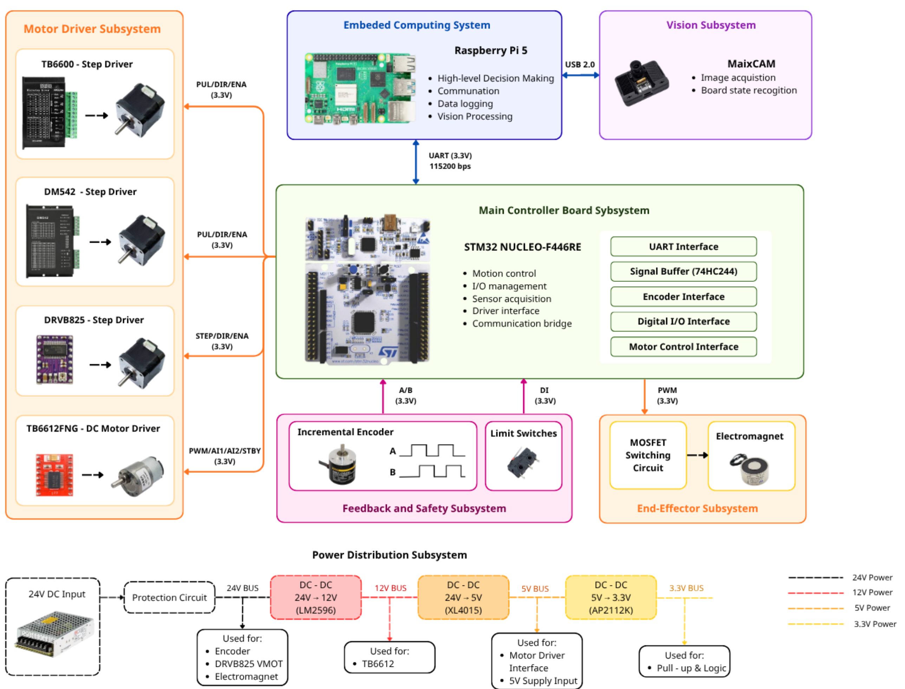

# STM32 Firmware — 4-DOF SCARA Robot Controller

> **Bare-metal C firmware** for an STM32F446RE Nucleo board that performs real-time motion control, inverse kinematics, and automated pick-and-place for a custom 4-DOF SCARA robot.

---

## System Control Flow

The diagram below shows the complete hardware-software architecture: the STM32 acts as the central controller bridging motor drivers, encoder feedback, safety switches, and a Raspberry Pi 5 for high-level decision making.



| Subsystem | Components | Interface |
|---|---|---|
| **Main Controller** | STM32 NUCLEO-F446RE | — |
| **Motor Drivers** | DM542, TB6600, DRV8825 (steppers) · TB6612FNG (DC) | PUL/DIR/ENA, PWM (3.3 V) |
| **Feedback & Safety** | 4× Omron 2000 PPR encoders · 1× 11 PPR DC encoder · 6× limit switches | TIM2/3/4 encoder mode, EXTI, GPIO |
| **End Effector** | Electromagnet via MOSFET switching circuit | PWM (3.3 V) |
| **Embedded Computing** | Raspberry Pi 5 ↔ STM32 (UART 115200 bps) | UART |
| **Vision** | MaixCAM → Raspberry Pi 5 | USB 2.0 |
| **Power** | 24 V → 12 V (LM2596) → 5 V (XL4015) → 3.3 V (AP2112K) | Multi-rail DC-DC |

---

## Firmware Architecture

The firmware runs a **bare-metal cooperative super-loop** — no RTOS. A TIM6 interrupt at **20 kHz** (50 µs) drives stepper pulse generation at the highest priority, while the main loop polls all other services sequentially:

```
main()
  ├─ HAL_Init / Clock / GPIO / Timer / UART Initialization
  ├─ Robot_Init_State()          ← Parallel homing with encoder-tracked offsets
  └─ while(1)  ──────────────────── Super Loop ────────────────────
       ├─ UART_Command_Service()          CLI command parser
       ├─ Encoders_Update()               Poll TIM2/3/4 counters
       ├─ Limit_Safety_Service()          Hardware limit auto-reverse
       ├─ Software_Limit_Service()        Encoder-based soft limits
       ├─ Encoder_Stall_Service()         Stall detection (500 ms timeout)
       ├─ Robot_Joint_Task_Service()      Open-loop IK joint dispatcher
       ├─ Robot_Multi_IK_PD_Service()     Multi-waypoint IK sequencer
       ├─ Robot_Auto_Sequence_Service()   Pick-and-place state machine
       ├─ PD_Test_Service()               Single-joint PD test loop
       ├─ Multi_PD_Service()              4-joint simultaneous PD control
       ├─ RobotUartDebug_Process()        Binary protocol from RPi5
       └─ UART_TX_Service()              Non-blocking TX buffer flush
```

### Source File Map

| File | Purpose |
|---|---|
| `main.c` | Entry point, peripheral init, super-loop, kinematic constants (S, M, T_d) |
| `Robot_Control.c` | IK solver (Newton-Raphson + DLS), homing, joint dispatcher, auto pick-and-place state machine |
| `Custom_CLI.c` | UART command parser (40+ commands: ptp_run, auto_con, pid_run, etc.) |
| `Custom_utils.c` | PD test harness, Multi-PD controller, DWT microsecond timer, Cartesian conversion |
| `Controllers.c` | PD_Stepper_Compute, PD_DC_Compute with slew-rate limiting and deadband |
| `HW_Encoders.c` | TIM encoder-mode driver (x4 decode), EXTI quadrature for DC motor, angle/velocity conversion |
| `HW_Motors.c` | Stepper state machine (enable/dir/step), DC motor PWM via TIM12 |
| `HW_LimitSwitches.c` | 6 limit switches: hardware auto-reverse, software limits, stall detection |
| `HW_EndEffector.c` | Electromagnet on/off control |
| `PoE_Kinematics.c` | Forward kinematics (Product of Exponentials), Space Jacobian |
| `PoE_lieTheory.c` | se(3)/so(3) matrix exponential, twist algebra |
| `PoE_matrixManip.c` | 4×4 matrix utilities (inverse, multiply, transpose) |
| `robot_uart_debug.c` | Binary UART protocol for Raspberry Pi 5 communication |

---

## Input Sensors — Incremental Encoders

### Reading Method

All encoders use STM32 hardware timer encoder mode (x4 quadrature decoding), except the DC motor encoder which uses a software EXTI-driven quadrature state machine:

| Motor | Encoder | Timer | Decode | CPR (Counts/Rev) |
|---|---|---|---|---|
| M1 (DM542) | Omron 2000 PPR | TIM2 (32-bit) | Hardware x4 | **8,000** |
| M2 (TB6600) | Omron 2000 PPR | TIM3 (16-bit) | Hardware x4 | **8,000** |
| M3 (DC) | 11 PPR | EXTI (PA11/PA12) | Software x4 (QEM LUT) | **44** |
| M4 (DRV8825) | Omron 2000 PPR | TIM4 (16-bit) | Hardware x4 | **8,000** |

**Update rate**: `Encoders_Update()` runs every super-loop iteration (effectively continuous); the PD control loop samples at **100 Hz** (10 ms period).

### Minimum Positioning Error — Discrete Pulse Analysis

Since encoder counts are integer, the minimum detectable angular displacement is:

$$\Delta\theta_{min} = \frac{360°}{\text{PPR} \times 4}$$

And for the PD controller, the actuator-side minimum (stepper resolution) also matters:

$$\Delta\theta_{step} = \frac{360°}{\text{Steps/Rev}}$$

The **deadband** (`Err_Min`) must be set above the larger of these two constraints to prevent limit-cycle oscillation:

| Motor | Encoder Resolution | Actuator Resolution | Deadband (`Err_Min`) | Rationale |
|---|---|---|---|---|
| **M1** | 0.045°/count | 0.225°/step (1600 µsteps) | **0.3°** | 1.33× stepper step — conservative margin |
| **M2** | 0.045°/count | 0.225°/step (1600 µsteps) | **0.3°** | Same as M1 |
| **M3** | **8.18°/count** | Continuous (DC PWM) | **4.0°** | Encoder is the bottleneck — only 44 CPR |
| **M4** | 0.045°/count | 0.45°/step (800 µsteps) | **2.5°** | Extra margin for belt backlash on Z-axis |

> **Key insight for M3**: With only 44 CPR (11 PPR × 4), one encoder count spans **8.18°** of rotation. The feedback quantization is so coarse that the controller cannot distinguish errors smaller than ±1 count. The deadband is set to 4.0° as a practical compromise, accepting that the DC motor will settle within ±1 count (~±8°) of the target.

### Velocity Estimation

Velocity is computed from finite differences with an optional first-order low-pass (EMA) filter:

```c
// Raw velocity: Δθ / Δt
float Encoder_To_Velocity(current_counts, previous_counts, delta_time_sec, ppr, unit);

// Smoothed: α·raw + (1-α)·prev  (α configurable via CLI, default 0.2)
float Encoder_To_Velocity_Smoothed(..., float *filtered_vel_state);
```

---

## Software Safety — Limit Switches

Three layers of protection run every super-loop cycle to prevent mechanical damage:

### Layer 1 — Hardware Limit Auto-Reverse (`Limit_Safety_Service`)

When a physical limit switch triggers **while the motor is moving toward it**, the firmware:
1. **Immediately reverses** the motor direction (stepper) or **stops** (DC motor)
2. Tracks the reverse distance via encoder
3. If still triggered after **2° of reverse travel** → flags as **jammed** and halts the motor

```
State Machine per motor:
  TRIGGERED while moving toward limit → reverse direction
  STILL TRIGGERED after 2° reverse    → JAMMED → full stop
  RELEASED                            → clear jam flag, stop reverse
```

### Layer 2 — Software Angle Limits (`Software_Limit_Service`)

Encoder-based soft limits prevent exceeding the mechanical workspace, even without a physical switch:

| Motor | Soft Limit | Physical Meaning |
|---|---|---|
| M1 | ±180° | Base rotation range |
| M2 | ±200° | Elbow rotation range |
| M3 | ±180° | Wrist rotation range |
| M4 | ±95 mm | Z-axis linear travel (via 13 mm pulley) |

The service only stops the motor when it is actively moving **away from home** past the limit — it never blocks the return direction.

### Layer 3 — Encoder Stall Detection (`Encoder_Stall_Service`)

If a motor is commanded to run but the encoder count remains unchanged for **500 ms**, the motor is assumed to be stalled (mechanical jam, lost steps, or disconnected encoder) and is immediately stopped.

### Initialization Safety

During `Robot_Init_State()`, additional checks run:
- **Encoder health check**: Every 1000 steps, verifies encoder delta > 10 counts. If not → e-stop ("ENCODER DEAD")
- **Limit switch timeout**: If any limit switch remains triggered for > 2 seconds continuously → e-stop ("DISCONNECTED?")

---

## Main Control Functions

### `ptp_run_con_<id>_<θ>_<X>_<Y>_<Z>` — Point-to-Point with PD Control

**CLI command**: `ptp_run_con_1_0.0_0.250_-0.011_0.08`

This is the primary **closed-loop** motion command. It converts a Cartesian target `(θ, X, Y, Z)` into joint angles via inverse kinematics, then drives all 4 joints simultaneously using tuned PD controllers.

**Execution flow:**

```
CLI Parse (Custom_CLI.c)
  │
  ├─ Convert_PTP_to_Td()           → Build 4×4 homogeneous transform T_d from (θ,x,y,z)
  │
  ├─ Robot_Set_IK_Target_PD(T_d, controller_id)
  │     │
  │     ├─ Safeguard 1: Reachability check (XY radius ≤ 0.35 m)
  │     │
  │     ├─ Newton-Raphson IK (max 100 iterations, ε < 1e-6)
  │     │     ├─ ForwardKinematics_Space(M, S, θ)  →  T_EE
  │     │     ├─ Compute_Twist_Error(T_d, T_EE)    →  V_EE (6×1 twist error)
  │     │     ├─ jacobianSpace(S, θ)                →  Js  (6×4 Jacobian)
  │     │     ├─ DLS(Js)                            →  Js⁻¹ (Damped Least Squares pseudo-inverse)
  │     │     └─ Δθ = Js⁻¹ · V_EE                  →  update θ
  │     │
  │     ├─ Elbow flip: tries alternate IK solution if first attempt fails
  │     │
  │     ├─ Safeguard 2: Joint limit validation (M1 ≤ 180°, M2 ≤ 200°, M3 ≤ 180°, M4 ≤ 95mm)
  │     │
  │     └─ Multi_PD_Start(target_abs_deg[4], param_idx)
  │           └─ Dispatches all 4 joints to simultaneous PD control loops
  │
  └─ Multi_PD_Service()  ← runs in super-loop at 100 Hz
        ├─ For each joint: error = target° − encoder°
        ├─ PD_Stepper_Compute() → step interval [µs] (steppers)
        ├─ PD_DC_Compute()      → PWM value (DC motor)
        ├─ Slew-rate limiter prevents step-frequency jumps
        └─ Logs [PTP_DATA] CSV at 100 Hz for external analysis
```

**Controller parameters** (two sets per motor, selectable via `controller_id`):

| Motor | Set 1 (Kp, Kd) | Set 2 (Kp, Kd) |
|---|---|---|
| M1 (Base) | 22.0, 0.0 | 10.0, 0.0 |
| M2 (Elbow) | 20.0, 0.0 | 20.0, 0.0 |
| M3 (Wrist) | 8.0, 5.0 | 9.6, 1.8 |
| M4 (Z-axis) | 4.5, 0.0 | 1.0, 0.0 |

---

### `auto_con_1_mag_on_<θ>_<pX>_<pY>_mag_off_<plX>_<plY>` — Automated Pick-and-Place

**CLI command**: `auto_con_1_mag_on_0.0_0.250_-0.011_mag_off_0.200_0.100`

A fully automated **finite-state machine** that orchestrates a complete pick-and-place cycle using PD-controlled IK moves and electromagnet actuation. The `_mm` suffix can be appended to accept coordinates in millimeters.

**State machine:**

```
AUTO_STATE_IDLE
  │
  ▼ Robot_Start_Auto_Pick_Place() — pre-checks reachability of BOTH coordinates
  │
  ═══════════════ PICK PHASE ═══════════════
  │
  ├─► MOVE_XY_PICK         IK move to (pickX, pickY) at z = 0.08 m (safe height)
  │     └─► wait Robot_Is_Moving() == false
  │
  ├─► MOVE_Z_DOWN_PICK     IK move to z = 0.0105 m (approach surface)
  │     └─► wait Robot_Is_Moving() == false
  │
  ├─► WAIT_SWITCH           Magnet ON → wait for Limit5 AND Limit6 triggered
  │                          (contact confirmation sensors on end-effector)
  │
  ├─► DELAY_PICK            200 ms dwell time for secure magnetic grip
  │     └─► Report UART_STATUS_PICKED to RPi5
  │
  ├─► MOVE_Z_UP_PICK        IK move to z = 0.08 m (lift object)
  │
  ═══════════════ PLACE PHASE ══════════════
  │
  ├─► MOVE_XY_PLACE         IK move to (placeX, placeY) at z = 0.08 m
  │
  ├─► MOVE_Z_DOWN_PLACE     IK move to z = 0.02 m (release height)
  │
  ├─► MAGNET_OFF             Deactivate electromagnet → release object
  │     └─► Report UART_STATUS_PLACED to RPi5
  │
  ├─► MOVE_Z_UP_PLACE       IK move to z = 0.08 m
  │
  ═══════════════ RETURN HOME ══════════════
  │
  ├─► MOVE_HOME              Multi_PD_Start({0,0,0,0}) → return to encoder zero
  │     └─► Report UART_STATUS_DONE to RPi5
  │
  └─► IDLE
```

**Safety integration**: Every state transition checks `e_stop_active`. If triggered at any point, the state machine resets to `IDLE` and all motors stop. The reachability pre-check at entry prevents the sequence from starting if either pick or place coordinates exceed the 0.35 m workspace radius.

---

## Build & Flash

- **IDE**: STM32CubeIDE
- **MCU**: STM32F446RET6 (16 MHz HSI, no PLL)
- **Math Library**: CMSIS-DSP (`arm_math.h`) for matrix operations
- **Debug**: ST-Link via SWD, UART2 for CLI at 115200 baud
